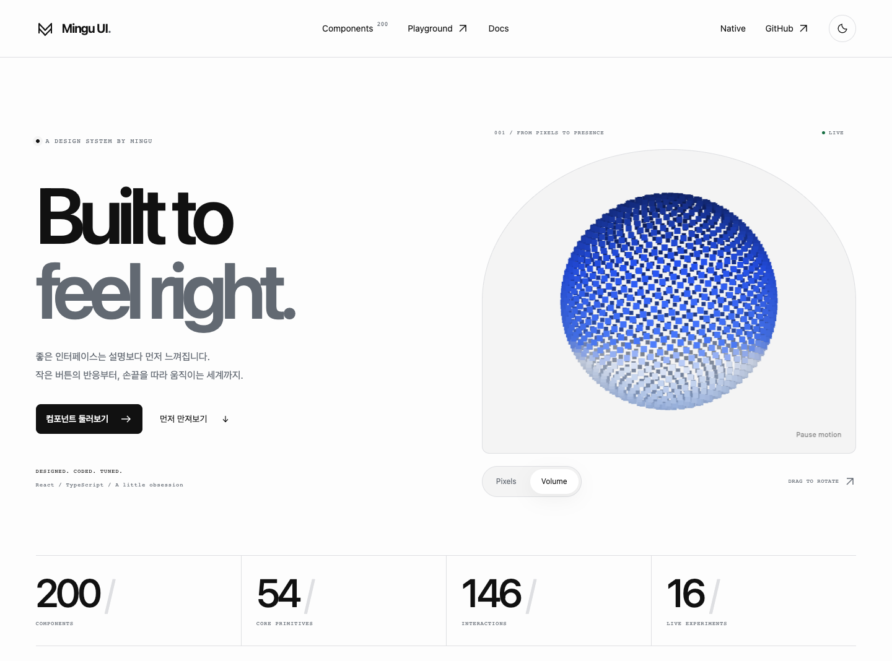

<div align="center">

# Mingu UI.

**Built to feel right.**

기본 입력부터 손끝을 따라 움직이는 인터랙션까지.<br />
React와 React Native를 위한 하나의 디자인 시스템.

**200 Web components · 55 Native components · 16 live experiments**

[**Live demo ↗**](https://ui.mingu.xyz) · [Components](https://ui.mingu.xyz/all) · [Playground](https://ui.mingu.xyz/playground) · [Docs](https://ui.mingu.xyz/docs) · [Native](https://ui.mingu.xyz/native)

<a href="https://ui.mingu.xyz">
  <picture>
    <source media="(prefers-color-scheme: dark)" srcset="./docs/public/readme/demo-dark.png" />
    
  </picture>
</a>

<sub>실제 라이브 데모 화면입니다. 이미지를 누르면 직접 조작할 수 있습니다.</sub>

</div>

## 먼저 만져보기

| Demo                                              | 여기서 할 수 있는 것                                                                               |
| ------------------------------------------------- | -------------------------------------------------------------------------------------------------- |
| [**Live demo**](https://ui.mingu.xyz)             | 입자 조형물을 회전하고, Pixels와 Volume을 전환하고, 토큰 작업대에서 시스템의 표정을 바꿉니다.      |
| [**Components**](https://ui.mingu.xyz/all)        | 웹 컴포넌트 200개를 라이브 미리보기로 탐색합니다. 카드를 열면 더 큰 데모와 사용 코드로 이어집니다. |
| [**Playground**](https://ui.mingu.xyz/playground) | 천을 잡아당기고, 입자를 휘젓고, 궤도를 편집하는 실험 16개를 전체 화면에서 조작합니다.              |
| [**Controls**](https://ui.mingu.xyz/controls)     | 버튼·입력의 크기, 테마와 상태를 바꾸며 실제 결과와 코드를 비교합니다.                              |
| [**Docs**](https://ui.mingu.xyz/docs)             | 컴포넌트 검색, API와 상태별 예제를 확인합니다.                                                     |
| [**Native**](https://ui.mingu.xyz/native)         | iOS·Android 설치 안내와 Native 목록을 확인합니다. 실제 실행은 아래 Expo 예제를 사용합니다.         |

바로 열어볼 실험: [Cloth playground](https://ui.mingu.xyz/playground/cloth-playground) · [Elastic mesh](https://ui.mingu.xyz/playground/elastic-mesh) · [Orbit composer](https://ui.mingu.xyz/playground/orbit-composer)

## 하나의 시스템, 다른 쓰임

| Layer           | 구성                                                                                     |
| --------------- | ---------------------------------------------------------------------------------------- |
| **Foundation**  | 색상·간격·타이포그래피·반경·모션 토큰. 웹과 Native가 같은 기본 값을 공유합니다.          |
| **Core**        | Button, TextField, Select, Checkbox, Tabs, Dialog 등 제품 화면의 기본 구성 요소.         |
| **Interaction** | 스크롤, 탐색, 제스처, 텍스트, 미디어와 피드백. 목적에 맞게 조합하는 움직임.              |
| **Playground**  | Canvas·WebGL·물리 상호작용을 탐색하는 실험 공간. 개별 컴포넌트로도 가져다 씁니다.        |
| **Native**      | RN 기본 UI, 안전 영역, 키보드 대응, 모달과 날짜·금액·일정 입력. 별도의 `/native` 진입점. |

- 테마는 Provider 범위에 적용합니다. `light`, `dark`, `system`과 브랜드·중립 강조색을 조합합니다.
- 미리보기와 소비 앱이 같은 컴포넌트를 사용합니다. 데이터와 이벤트는 props·callback으로 연결합니다.
- 키보드·터치·비활성·오류·모션 감소 상태를 함께 다룹니다. 무거운 갤러리 데모는 화면 근처에서 마운트합니다.
- 저장·인증·급여 계산 같은 제품 로직은 소비 앱에 둡니다.

## Web quick start

**React 19+**, TypeScript 소스를 처리하는 번들러가 필요합니다. npm 레지스트리 대신 Git 의존성 또는 submodule로 사용합니다.

아래는 벡터 아이콘 개선이 포함된 0.26.1 커밋으로 고정한 설치 예제입니다.

```sh
npm install 'git+https://github.com/Linternas/ui.git#4e793f282a09c6900221144a131ab258dc0177ce'
```

```tsx
import {
  DesignSystemProvider,
  Button,
  Card,
  Stack,
  TextField,
} from "@mingu/interaction-ui/system";
import "@mingu/interaction-ui/system.css";

export function CreateProject() {
  return (
    <DesignSystemProvider theme="system" accent="neutral" motion="system">
      <Card>
        <Stack gap="4">
          <TextField label="프로젝트 이름" placeholder="My next idea" />
          <Button interaction="press">프로젝트 만들기</Button>
        </Stack>
      </Card>
    </DesignSystemProvider>
  );
}
```

Next.js에서는 `transpilePackages: ['@mingu/interaction-ui']`를 설정하고 CSS를 루트 layout에서 불러옵니다. Vite 등 TSX를 처리하는 React 번들러에서도 같은 진입점을 사용합니다. Tailwind나 Next.js를 라이브러리의 필수 의존성으로 요구하지 않습니다.

인터랙션은 필요한 컴포넌트와 스타일을 함께 가져옵니다.

```tsx
import { CodeBlock, RailToc, ScrollProgress } from "@mingu/interaction-ui";
import "@mingu/interaction-ui/styles.css";
```

| Import                          | 용도                                |
| ------------------------------- | ----------------------------------- |
| `@mingu/interaction-ui`         | 인터랙션과 통합 웹 컴포넌트 exports |
| `@mingu/interaction-ui/system`  | Core UI와 웹 테마 Provider          |
| `@mingu/interaction-ui/catalog` | 런타임 없는 카탈로그 메타데이터     |
| `@mingu/interaction-ui/tokens`  | 플랫폼 공통 토큰과 타입             |
| `@mingu/interaction-ui/native`  | React Native 컴포넌트와 Provider    |

[테마·토큰·통합 가이드](./DESIGN_SYSTEM.md) · [전체 컴포넌트와 상태](./COMPONENTS.md) · [Next.js 예제](./examples/next-page.tsx)

앱의 전역 모션은 Provider의 `motion="system" | "full" | "reduced"`로 설정합니다. 기본은 OS 설정을 따르는 `system`이며 중첩 영역은 상위 값을 상속합니다. [모션 정책과 설정 화면 연결](./DESIGN_SYSTEM.md#전역-모션-정책-0270)을 참고하세요. `ui.mingu.xyz` 데모는 `full`로 실행합니다.

## React Native

Native는 DOM·CSS를 사용하지 않는 별도 구현입니다. 웹 import와 혼용하지 않습니다.

Button, TextField, Select, BottomNavigation, Toast, Dialog 등의 기본 UI에 **MoneyField, MonthPicker, DateRangePicker, Calendar, WeekdayPicker**를 제공합니다. 모달은 고정 footer, 크기 선택과 앱이 보류할 수 있는 닫기 요청을 지원합니다.

**휴대폰에서 데모 실행** — SDK 57을 지원하는 Expo Go가 필요합니다.

```sh
git clone https://github.com/Linternas/ui.git
cd ui/examples/native
npm ci
npm start
```

컴퓨터와 휴대폰을 같은 Wi-Fi에 연결하고 QR을 스캔합니다. **Components / Inputs / Planning / More** 탭에서 테마, 입력·선택, 달력·금액과 긴 모달 폼을 직접 조작할 수 있습니다. iOS에서 로그인을 요청하면 CLI와 Expo Go에 같은 Expo 계정을 사용합니다.

```tsx
import {
  NativeProvider,
  Screen,
  Button,
  TextField,
} from "@mingu/interaction-ui/native";

export function NativeExample() {
  return (
    <NativeProvider theme="system" accent="neutral">
      <Screen>
        <TextField label="이름" placeholder="Mingu" />
        <Button>계속하기</Button>
      </Screen>
    </NativeProvider>
  );
}
```

소비 앱에는 해당 SDK에 맞는 safe-area-context, datetimepicker, slider도 설치해야 합니다. 설치 버전과 nullable 날짜·금액 문자열·날짜 범위의 값 규약은 [Native API](./NATIVE.md)를 따릅니다.

[Expo 예제와 실행 안내](./examples/native/README.md) · [Android 검증 화면](./docs/qa/native-planning-2026-10-26.md)

Android 에뮬레이터에서 실제 조작과 320pt·큰 글씨 검수를 진행했습니다. iPhone 화면과 Granite·앱인토스 실행 환경의 호환 여부는 별도 검증 대상입니다.

## 로컬에서 데모 실행

Node 22 / npm 10.9 기준입니다.

```sh
git clone https://github.com/Linternas/ui.git
cd ui
npm ci
npm run build
npm start
```

`http://localhost:3000`에서 랜딩, `/all`에서 전체 갤러리, `/docs`에서 문서, `/playground`에서 실험 공간을 엽니다. `PORT`로 포트를 바꿀 수 있습니다. 소스를 바꾼 뒤에는 다시 빌드합니다.

Railway는 저장소 루트의 `railpack.json`을 사용합니다. Build는 `npm run build`, Start는 `npm start`, health check는 `/healthz`이며 서버는 `0.0.0.0:$PORT`에 바인딩합니다.

<details>
<summary><strong>소비 앱에서 submodule로 사용하기</strong></summary>

```sh
git submodule add https://github.com/Linternas/ui.git packages/interaction-ui
git submodule update --init --recursive
```

소비 앱의 package manager로 로컬 패키지를 연결합니다. 새로 clone할 때는 `--recurse-submodules` 또는 `git submodule update --init --recursive`를 실행합니다. 검증한 커밋의 gitlink를 소비 앱과 함께 커밋하고 TypeScript transpile·CSS import를 설정합니다.

</details>

## 개발과 문서

| 문서                                    | 내용                                       |
| --------------------------------------- | ------------------------------------------ |
| [Design system](./DESIGN_SYSTEM.md)     | 설계 원칙, 토큰, 테마와 웹 통합            |
| [Components](./COMPONENTS.md)           | 웹 컴포넌트 목록과 상태                    |
| [Native API](./NATIVE.md)               | 모바일 설치, API와 값 규약                 |
| [Collection guides](./docs/collections) | AI·미디어·워크플로·물리 실험별 사용법      |
| [Agent guide](./AGENTS.md)              | 에이전트가 읽을 소스 지도와 작업·검증 규칙 |

```sh
npm run typecheck         # 패키지·Native·엄격한 소비 앱 타입 검사
npm run typecheck:docs    # 웹 데모 타입 검사
npm run test:native       # Native 컴포넌트 동작 검사
npm run test:browser      # 웹 브라우저 회귀 검사
npm run test:docs         # 빌드와 데모 HTTP 서버 검사
```

브라우저 검사는 먼저 `npx playwright install chromium`을 실행합니다. 설치된 Chrome을 사용할 때는 `PLAYWRIGHT_CHANNEL=chrome npm run test:browser`를 사용합니다. Native의 Node 테스트와 Metro 번들 성공은 실제 기기 검증을 대체하지 않습니다.

---

<div align="center">

**Designed & built by Mingu.**<br />
[직접 만져보기 ↗](https://ui.mingu.xyz) · [시스템 살펴보기](https://ui.mingu.xyz/docs) · [소스](https://github.com/Linternas/ui)

</div>
